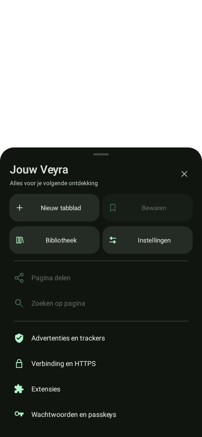
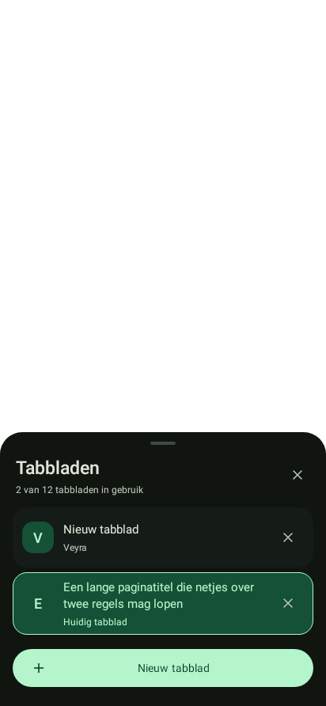
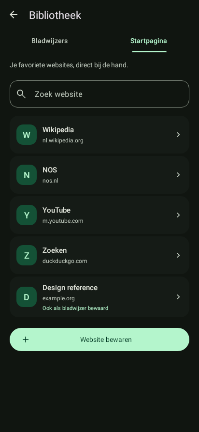

# Bibliotheek, browserpanelen en instellingen

Deze verbeteringen zijn beschikbaar in de [0.4.1-alpha](https://github.com/Tufein/Veyra/releases/tag/v0.4.1), als opvolger van 0.4.0.

## Eén herkenbare plek voor websites

**Menu → Bibliotheek** opent een eigen scherm met **Bladwijzers** en **Startpagina**. De startpagina toont dezelfde snelkoppelingen als de bibliotheek en de instellingen. Namen, domeinregels, websiteletters en kleuren gebruiken gedeelde componenten.

- Een website openen, bewerken, vastzetten of verwijderen heeft een benoemde actie. Verwijderen zit achter een bevestiging.
- **Op startpagina zetten** bewaart de website ook als bladwijzer. Er zijn maximaal acht snelkoppelingen; een volle startpagina maakt geen halve opslag aan.
- **Van startpagina halen** laat de bestaande bladwijzer staan.
- Een gekoppelde naam of URL bewerken werkt beide plaatsen in één voorkeurenbewerking bij. HTTP en HTTPS en verschillende paden/query’s blijven aparte adressen.
- Een bladwijzer verwijderen verwijdert ook de gekoppelde snelkoppeling. Het bevestigingsvenster legt dat uit.
- De vier oorspronkelijke standaardwebsites blijven staan. Er wordt bij het openen niets gemigreerd of overschreven. Een oudere snelkoppeling zonder bladwijzer kun je expliciet als bladwijzer bewaren.
- Zoeken, een lege lijst, een lege zoekopdracht en invoerfouten hebben een eigen toestand. De geselecteerde tab, zoektekst en editorinvoer blijven behouden bij schermrotatie.

De bestaande `bookmarks`- en `shortcuts`-JSON en alle andere voorkeurensleutels blijven bruikbaar. Ongeldige adressen en dubbele genormaliseerde URL’s worden bij opslaan geweigerd. Beschadigde opslag wordt bij lezen of een niet-gerelateerde bewerking niet vervangen.

## Browserbediening

Het lange Android-keuzelijstvenster maakt plaats voor een Material-paneel vanaf de onderkant. Bovenaan staan vier herkenbare acties: nieuw tabblad, bewaren, bibliotheek en instellingen. Pagina-acties zijn uitgeschakeld als er geen website open is; een bestaande bladwijzer toont **Opgeslagen**. Advertentieblokkering, verbinding, extensies en wachtwoordopties staan in de lijst eronder. **Over Veyra** blijft beschikbaar in de instellingen.

Tabbladen gebruiken hetzelfde paneel met een zichtbaar geselecteerde rij, een aparte sluitknop en een knop voor een nieuw tabblad. De limiet van twaalf tabbladen is zichtbaar en wordt ook door de knop gehandhaafd. De inhoud kan scrollen; grote tekst op een smal scherm zet de menuknoppen onder elkaar.

De startpagina heeft een kleinere introductie, websiteletters uit dezelfde component als de bibliotheek en directe toegang tot opgeslagen websites. Lang drukken op een snelkoppeling opent het beheer van de startpagina.

## Instellingen

De instellingen behouden hun eigen Activity en detailnavigatie. De nieuwe indeling gebruikt een compact introductiekaartje, kleine categorie-iconen, minder witruimte tussen rijen en één paginatitel in de werkbalk. Snelkoppelingen tonen een websiteletter en domein in plaats van een groot identiek linkpictogram en een volledige URL. Vanuit die lijst kies je bestaande bladwijzers in de bibliotheek; na terugkeer wordt de lijst vernieuwd.

## Schermvoorbeelden

Dit zijn renderingen van de werkelijke Android/Material-views met Robolectric native graphics. Ze zijn geen screenshots van een telefoon. Het zwarte gebied boven de panelen is de lege testactiviteit, niet de browserpagina.

| Browsermenu | Tabbladen |
| --- | --- |
|  |  |

| Bibliotheek / startpagina | Instellingen |
| --- | --- |
|  |  |

Meer voorbeelden: [licht menu](images/browser-menu-light.png), [lichte bibliotheek](images/library-startpage-light.png), [snelkoppelingen in instellingen](images/settings-shortcuts-dark.png), [menu op klein scherm met grote tekst](images/browser-menu-small-large-font.png), [bibliotheek op klein scherm met grote tekst](images/library-small-large-font.png).

## Gecontroleerd

De build, JVM-regressies, beschermingstests en Android Lint zijn lokaal gecontroleerd. De nieuwe tests richten zich op gekoppelde opslag, maximale capaciteit zonder gedeeltelijke opslag, dubbele/ongeldige adressen, verwijderen met bevestiging, editorherstel, zoek-/tabherstel, browserresultaten, uitgeschakelde menuacties en aparte tabbladselectie/sluitknoppen. Zie [verificatie](verification-library.md).

De APK’s voor ARM64, ARMv7 en x86_64 en de connected-test-APK zijn gebouwd. Fysieke apparaatcontrole van gebaren, toetsenbord, OEM-kleuren en live Gecko-sessies blijft open. De ondertekeningsbeperkingen van de gepubliceerde alpha veranderen niet door deze vormgevingsronde.
