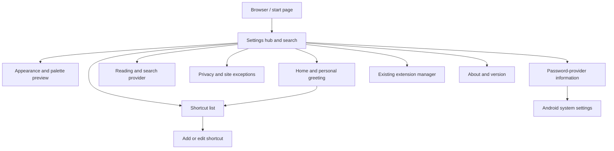
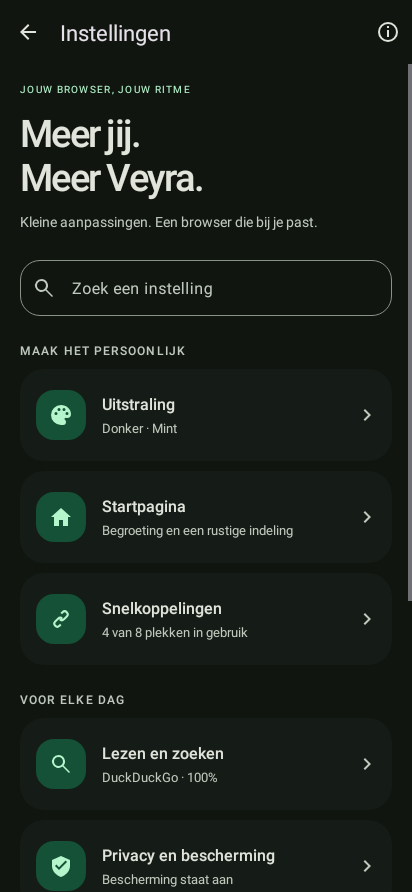
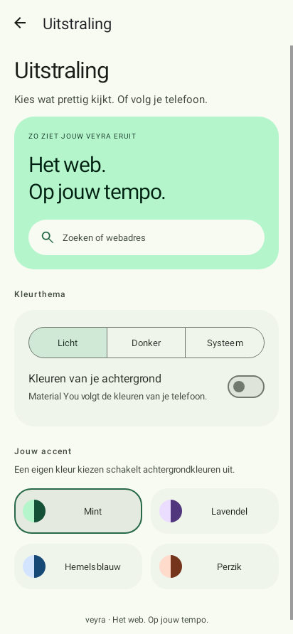

# Settings design: 0.4.0 development

The settings area is an independent Android activity. It starts with a searchable hub and opens focused detail pages; the browser's address bar and navigation controls do not appear on these screens.

## Navigation

Back and the toolbar arrow return to the previous settings destination; only Back from the hub closes the settings activity. Direct links from the start-page shortcut editor open the same settings area. Navigation, scroll position, and in-progress form fields survive recreation. Saved changes retain the existing preference keys and are applied to the browser on return.

## Visual direction

- A calm, typographic header and clear search affordance rather than a long flat preferences form.
- Material 3 cards with tonal surfaces, consistent radii, and grouped categories.
- Shared primary, container, surface, and outline colors across settings and the start page.
- A live browser-color preview and two-tone accent swatches; wallpaper-derived colors remain available on Android 12+.
- Theme controls adapt to a vertical layout when small screens and large text would truncate labels.
- Touch targets of at least 48 dp, semantic labels, visible selection, and motion that respects Android's animation setting.
- A maximum content width on larger displays, with scrollable detail pages and explicit empty/error states.

## Rendered Android UI

These images are generated by **Robolectric native graphics from the actual Android views and Material resources**. They are useful for reviewing the implementation and catching layout errors. They were not captured on a physical device and do not verify Gecko browsing, OEM wallpaper colors, the keyboard, or system gesture behavior.

| Settings hub, dark | Appearance, light |
| --- | --- |
|  |  |

Additional renderings: [light hub](images/settings-overview-light.png), [dark custom accent](images/settings-appearance-dark.png), [small screen with large text](images/settings-appearance-small-large-font.png), [reading controls](images/settings-reading-dark.png).

## Verification boundaries

The regression suite exercises search and empty results, detail Back navigation, saved compact-mode preferences, theme selection and recreation, accent changes, shortcut validation and editing, draft preservation, Android 9 fallback, and small-screen layout. Device verification is still required for native back gestures, real wallpaper extraction, keyboard/inset behavior, and interaction with a live browser session.
